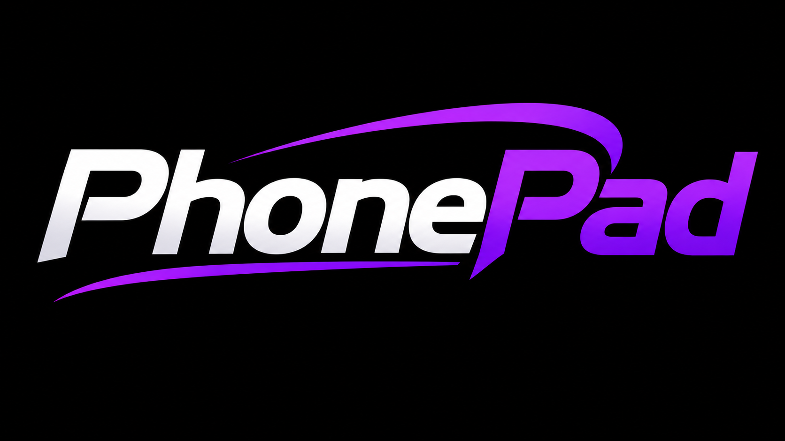

  

  # 📱 PhonePad 💻
  ### **PC Remote, Low-Latency Touchpad & Wireless Microphone**
  ### **حوّل هاتفك إلى لوحة تحكم، ماوس سريع، ومايكروفون لاسلكي للكمبيوتر**

  

    
    
    
    
    
  

---

> ⚠️ **المشروع قيد التطوير.** المزايا المذكورة هنا هي خطة النسخة الأولى، وبتتعلّم كمكتملة في قسم خارطة الطريق لما تتنفّذ فعلًا.

## 🌟 نظرة عامة | Overview

**PhonePad** مشروع مفتوح المصدر يربط هاتفك الأندرويد بجهاز الكمبيوتر (Windows 10/11) باستجابة سريعة على الشبكة المحلية (الهدف من **20 إلى 50 مللي ثانية** على Wi-Fi). تصميم السيرفر مستوحى من بساطة `PhoneMic v0.4.1`، مع إضافات للتحكم في النظام والوسائط.

---

## 🔥 المميزات المخططة | Planned Features

| القسم (Category) | المميزات (Features) |
| :--- | :--- |
| **📡 الاتصال** *(Connection)* | • **Wi-Fi (LAN)** مع اكتشاف تلقائي للشبكة أو ربط سريع عبر **QR Code**. • **USB** و**Bluetooth** في مرحلة لاحقة. • تشفير البيانات بـ **AES-256-GCM** بمفتاح مشتق من الـ PIN عبر PBKDF2. |
| **🖱️ تاتش باد 60 إطار/ثانية** *(60FPS Touchpad)* | • نقرة بإصبع (كليك شمال) \| نقرة بإصبعين (كليك يمين) \| ضغطة مطولة (Drag & Drop). • تمرير بإصبعين (Scroll) \| تقارب وتباعد الأصابع (**Pinch to Zoom**). |
| **🎙️ مايكروفون لاسلكي** *(Wireless Mic)* | • زر يحوّل مايكروفون الهاتف إلى مايك لاسلكي للويندوز، مثالي للمكالمات والتسجيل. يحتاج تثبيت **VB-CABLE** على الكمبيوتر. |
| **🎵 تحكم بالوسائط** *(Media Keys)* | • 11 زر وسائط: `Play/Pause`, `Next`, `Prev`, `Stop`, `Mute`, `Vol+`, `Vol-`, `Repeat`, `Shuffle`، وتقديم/تأخير بثواني قابلة للتخصيص. • **توجيه الأوامر لبرنامج محدد** حتى لو كان في الخلفية. |
| **🎚️ مكسر صوت التطبيقات** *(Per-App Volume Mixer)* | • التحكم في مستوى صوت كل برنامج مفتوح على الويندوز من شاشة الهاتف. |
| **⚙️ النظام والكيبورد** *(System & Keyboard)* | • `Shutdown`, `Restart`, `Sleep`, `Screenshot`, `Show Desktop`, `Alt+Tab`، والتحكم في **سطوع الشاشة**. • كيبورد كامل + وضع الأزرار الخاصة (`Ctrl, Alt, Shift, Win, Esc, F1-F12`). • مشاركة الحافظة (**Clipboard Sync**) بتفعيل يدوي. |
| **🎨 واجهة قابلة للتخصيص** *(Customizable UI)* | • 3 أوضاع: **Light**, **Dark**, و **AMOLED Pure Black**. • اهتزاز لمسي (**Haptic Feedback**) بشدة قابلة للتحكم. • وضع عمودي وأفقي وترتيب أزرار قابل للتخصيص. |

---

## 🖥️ سيرفر الويندوز | Windows Server

* يعمل في الـ **System Tray** (بجوار الساعة) مع خيار التشغيل مع الويندوز.
* واجهة إعدادات نظيفة تعرض الـ IP والمنفذ والـ PIN وصورة الـ QR وحالة المايك.
* لو المنفذ مشغول، يبحث السيرفر عن منفذ فارغ ويطلب من المستخدم التأكيد أو التغيير.

---

## 🗺️ خارطة الطريق | Roadmap

- [ ] **النسخة الأولى (MVP):** التاتش باد 60FPS + أزرار الوسائط والصوت والنظام + المايك اللاسلكي.
- [ ] **اتصال USB و Bluetooth.**
- [ ] **وضع يد التحكم للألعاب (Gamepad Mode)** مع إعدادات جاهزة لأشهر الألعاب.
- [ ] **نقل الملفات السريع** بين الهاتف والكمبيوتر.

---

## 📥 التحميل والتثبيت | Download & Installation

1. افتح قسم **[Releases](../../releases)** في هذا المستودع.
2. حمّل **`PhonePad_Server.exe`** على جهاز الكمبيوتر (Windows 10 / 11).
3. حمّل **`PhonePad_App.apk`** وثبّته على هاتفك الأندرويد.
4. (للمايك اللاسلكي) ثبّت **[VB-CABLE](https://vb-audio.com/Cable/)** على الكمبيوتر.
5. افتح السيرفر، امسح كود الـ **QR** أو أدخل الـ **PIN**، وابدأ التحكم.

> الهاتف والكمبيوتر لازم يكونوا على نفس شبكة Wi-Fi. لو ظهر تنبيه من Windows Firewall اسمح للبرنامج على الشبكة الخاصة.

---

  <b>مشروع مفتوح المصدر بالكامل ❤️ | Free & Open Source Software (MIT)</b>

